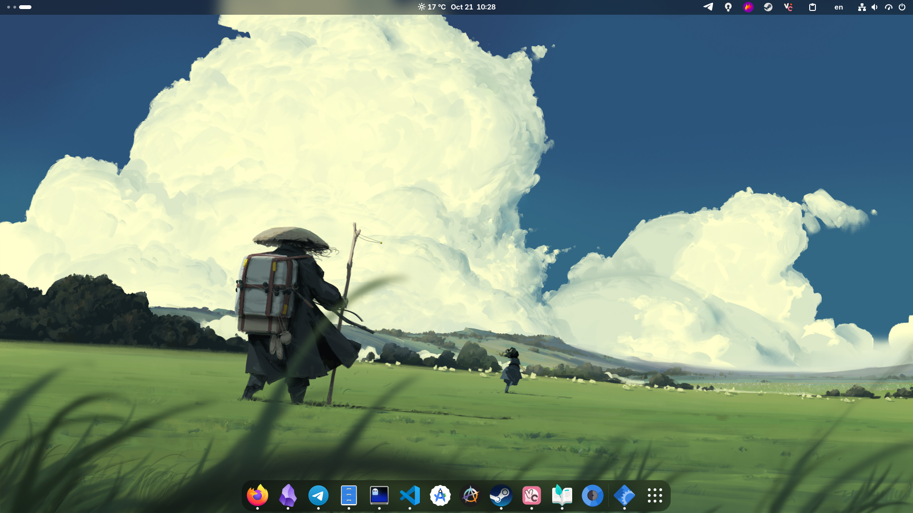

# My NixOS configuration for daily usage

  

---

## Apps

| Component             | Tool                | Role                                      |
| --------------------- | ------------------- | ----------------------------------------- |
| Desktop Environment   | Gnome               | Simple and beautifule desktop environment |
| Status Bar            | Waybar              | Fully configurable bar                    |
| Terminal              | Ghostty             | GPU-accelerated terminal emulator         |
| Shell                 | Fish                | Fast user friendly shell                  |
| TUI File Manager      | Yazi                | Blazing-fast terminal file manager        |
| GUI File Manager      | Nautilus            | Beautiful file manager                    |
| Editor                | Neovim              | Extensible modal text editor              |
| Screenshot            | Flameshot           | Fast screenshot application               |
| Audio                 | PavuControl         | Graphic sound mixer                       |
| System Info           | Fastfetch           | Fast, customizable fetch tool             |

---
